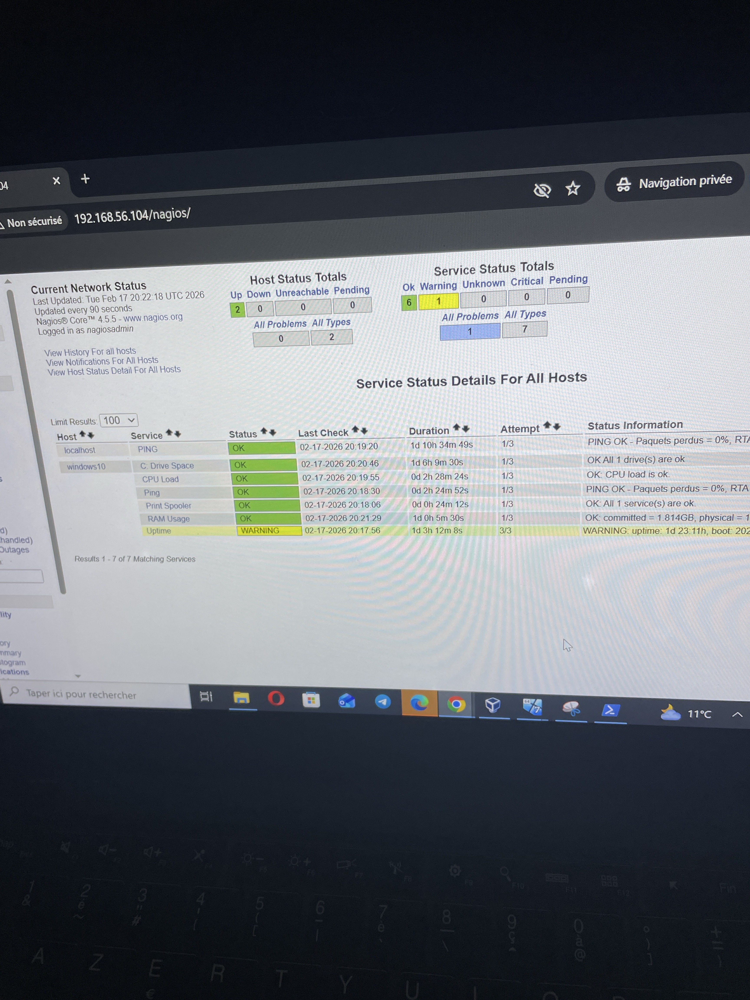
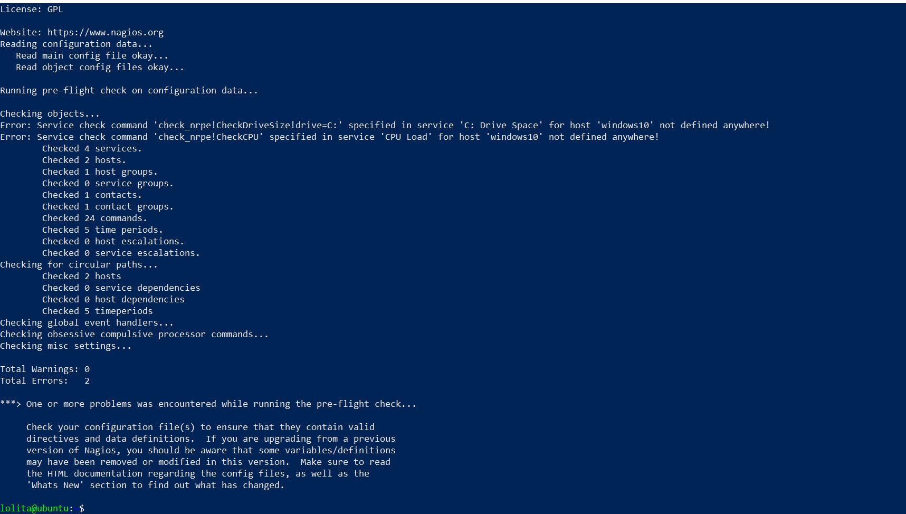
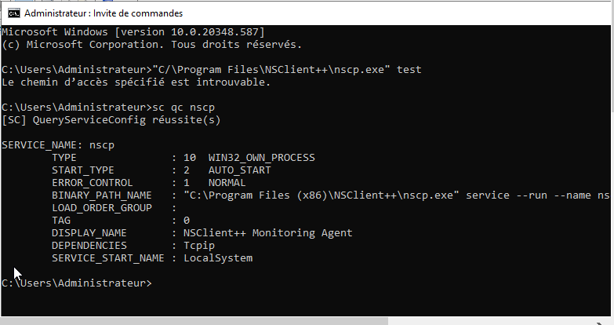
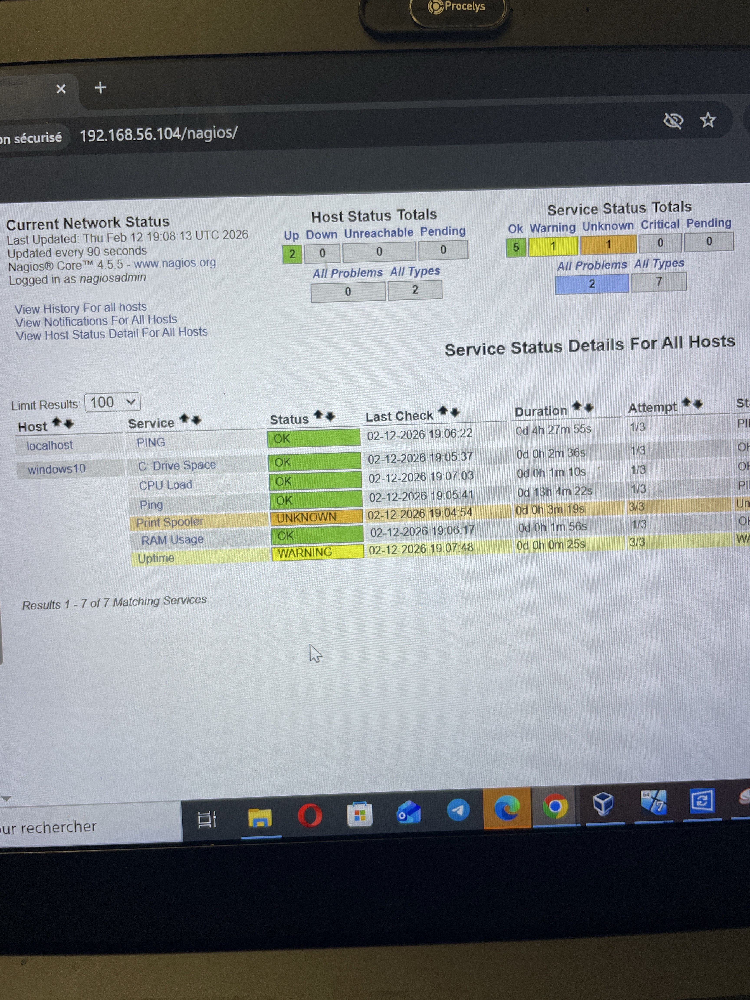

# 🖥️ Supervision d'une infrastructure Windows/Linux avec Nagios

### Projet technique — Administration systèmes, supervision et monitoring

**Réalisé par : Matine Lolita GNAMKOULAMBA**

**Domaine :** Administration systèmes | Supervision informatique | Infrastructure IT

**Technologies :** Nagios Core • Ubuntu Server • Windows • NRPE • Linux • Réseau TCP/IP

---

## 📌 1. Présentation du projet

Ce projet consiste à mettre en place un environnement de supervision informatique à l'aide de **Nagios**, une solution open source permettant de surveiller la disponibilité et l'état des systèmes et services informatiques.

L'objectif est de reproduire un environnement de supervision proche des besoins rencontrés dans une infrastructure d'entreprise.

Le laboratoire repose sur un serveur de supervision Linux et un environnement Windows.

Cette réalisation s'inscrit dans une démarche de développement de compétences en administration systèmes, surveillance des infrastructures et diagnostic technique.

---

## 🎯 2. Objectifs du projet

Les principaux objectifs sont :

- Installer et configurer une solution de supervision centralisée.
- Comprendre le fonctionnement de Nagios Core.
- Mettre en place la surveillance d'un environnement Windows/Linux.
- Configurer les mécanismes de communication nécessaires à la supervision.
- Vérifier la disponibilité des équipements et des services.
- Comprendre les différents états remontés par Nagios.
- Développer une méthodologie de diagnostic des incidents.
- Documenter les configurations et les résultats obtenus.

---

## 🏗️ 3. Architecture technique

### Environnement utilisé

| Composant | Technologie | Fonction |
|---|---|---|
| Serveur de supervision | Ubuntu Server | Hébergement de Nagios |
| Solution de monitoring | Nagios Core | Supervision centralisée |
| Système supervisé | Windows | Environnement de test |
| Mécanisme de supervision | NRPE | Exécution distante de contrôles |
| Réseau | TCP/IP | Communication entre les systèmes |
| Interface d'administration | Interface web Nagios | Consultation des états |

### Architecture logique

```text
        ADMINISTRATEUR SYSTÈMES
                  |
                  |
          Interface Web Nagios
                  |
                  v
       +----------------------+
       |    UBUNTU SERVER     |
       |                      |
       |     NAGIOS CORE      |
       |                      |
       |  Supervision         |
       |  Contrôles           |
       |  États des services  |
       +----------------------+
                  |
                  |
           Réseau TCP/IP
                  |
                  v
       +----------------------+
       |   SYSTÈME WINDOWS    |
       |                      |
       |  Hôte supervisé      |
       |  Services surveillés |
       +----------------------+
```

*Schéma logique simplifié du laboratoire de supervision.*

---

## ⚙️ 4. Mise en place de Nagios

### 4.1 Préparation de l'environnement

Le projet repose sur un environnement de laboratoire comprenant Ubuntu Server et Windows.

Les opérations de préparation comprennent notamment :

- La vérification de la connectivité réseau.
- La préparation du serveur Linux.
- La mise en place des composants nécessaires à la supervision.
- La configuration de l'environnement de test.

### 4.2 Installation de Nagios

Nagios constitue le composant central du projet.

Il permet notamment :

- La surveillance des hôtes.
- La vérification des services.
- La centralisation des informations de supervision.
- La consultation des résultats depuis une interface web.
- L'identification des états nécessitant une intervention.

### 4.3 Configuration des équipements

La configuration de Nagios repose sur la définition des équipements à surveiller et des contrôles associés.

Dans le cadre de ce laboratoire, la supervision a porté sur :

**1 hôte et 3 services.**

Cette configuration constitue une première étape vers la supervision d'une infrastructure plus étendue.

---

## 📊 5. Supervision et monitoring

Nagios permet de distinguer différents états de fonctionnement.

| État | Signification |
|---|---|
| OK | Service fonctionnel |
| WARNING | Situation nécessitant une attention |
| CRITICAL | Problème critique détecté |
| UNKNOWN | État du service indéterminé |
| UP | Hôte disponible |
| DOWN | Hôte indisponible |

Ces informations facilitent l'identification des anomalies et l'analyse des incidents.

### Résultats du laboratoire

Le laboratoire a permis de travailler sur :

- La configuration d'un hôte supervisé.
- La mise en place de trois contrôles de services.
- La consultation des informations de supervision.
- L'interprétation des états remontés par Nagios.

---

## 🔍 6. Diagnostic et dépannage

La supervision constitue une composante importante de l'administration des infrastructures informatiques.

Lorsqu'une anomalie est signalée, une démarche structurée peut être appliquée :

1. Identifier l'équipement ou le service concerné.
2. Examiner l'état remonté par Nagios.
3. Vérifier la connectivité réseau.
4. Contrôler les services et les configurations concernés.
5. Identifier l'origine du dysfonctionnement.
6. Appliquer une correction adaptée.
7. Vérifier le retour à un fonctionnement normal.
8. Documenter l'incident et les actions réalisées.

Cette démarche s'inscrit dans les bonnes pratiques de gestion des incidents informatiques.

---

## 📸 7. Captures d'écran et preuves techniques

Cette section est destinée à présenter les captures réelles du laboratoire.

Les illustrations permettront de documenter :

- L'interface principale de Nagios.
- Les équipements configurés.
- Les services supervisés.
- Les états de fonctionnement.
- Les vérifications techniques réalisées.

Les captures seront ajoutées progressivement afin de présenter des preuves visuelles des configurations et des résultats obtenus.

---

## 🛠️ 8. Compétences techniques mobilisées

### Administration Linux

- Utilisation d'Ubuntu Server.
- Configuration d'un environnement de supervision.
- Manipulation des services système.
- Diagnostic technique.

### Supervision informatique

- Utilisation de Nagios Core.
- Configuration des hôtes et des services.
- Consultation des états de supervision.
- Analyse des informations remontées.

### Réseaux

- Communication TCP/IP.
- Vérification de la connectivité.
- Compréhension des échanges entre systèmes.

### Exploitation informatique

- Surveillance des infrastructures.
- Identification des anomalies.
- Méthodologie de résolution des incidents.
- Documentation technique.

---

## 🚀 9. Perspectives d'amélioration

Plusieurs évolutions peuvent être envisagées :

- Ajouter davantage de machines supervisées.
- Étendre la surveillance à d'autres services.
- Configurer des notifications automatiques.
- Définir des seuils d'alerte adaptés.
- Centraliser davantage d'indicateurs.
- Documenter des scénarios de panne et leur résolution.
- Automatiser certaines opérations d'administration.

Ces améliorations permettraient de rapprocher progressivement le laboratoire d'un environnement de production.

---

## 🎓 10. Conclusion

Ce projet constitue une mise en pratique des principes de supervision et d'administration des systèmes informatiques.

Il permet de renforcer la compréhension des mécanismes de surveillance, de la disponibilité des services et du diagnostic des anomalies.

Il s'inscrit dans un parcours professionnel orienté vers les métiers de :

- Technicienne Support Informatique N2.
- Administratrice Systèmes Windows/Linux.
- Technicienne d'exploitation informatique.
- Administratrice Infrastructure IT.

---

**Auteure : Matine Lolita GNAMKOULAMBA**

*Projet personnel de laboratoire — Administration systèmes et supervision informatique.*

---

# 📸 Preuves techniques — Supervision Nagios

Cette section présente les principales vérifications techniques
réalisées dans le cadre de mon laboratoire de supervision
d'une infrastructure Windows/Linux avec Nagios.

L'objectif est d'illustrer les étapes de configuration,
de validation et de surveillance des systèmes et services.

## 1. Tableau de bord Nagios



**Description technique :**

Cette capture présente l'interface de supervision Nagios,
permettant de centraliser les informations relatives
aux hôtes et aux services surveillés.

Elle permet notamment de visualiser :
- L'état des hôtes supervisés.
- La disponibilité des services.
- Les alertes et les changements d'état.
- Les informations nécessaires au diagnostic.

## 2. Validation de la configuration Nagios



**Description technique :**

Cette capture illustre la vérification de la configuration
de Nagios avant son application.

Cette étape permet de contrôler la syntaxe des fichiers
de configuration et de détecter d'éventuelles erreurs
susceptibles d'empêcher le bon fonctionnement du service.

## 3. Supervision Windows avec NSClient++



**Description technique :**

Cette capture présente le service NSClient++ installé
sur le système Windows supervisé.

NSClient++ permet de rendre accessibles certaines
informations système à la plateforme de supervision,
selon les modules et les contrôles configurés.

## 4. Surveillance de la disponibilité et des alertes



**Description technique :**

Cette capture illustre la surveillance de la disponibilité
et la visualisation des états remontés par Nagios.

Les états de supervision permettent notamment
d'identifier les situations nécessitant une vérification
ou une intervention technique.

---

## 🎯 Compétences techniques mises en pratique

- Installation et configuration de Nagios Core sous Ubuntu Server.
- Supervision d'un environnement Windows/Linux.
- Configuration et utilisation de NRPE et NSClient++.
- Vérification des fichiers de configuration.
- Surveillance de la disponibilité des hôtes et des services.
- Analyse des états de supervision et des alertes.
- Diagnostic et dépannage d'une infrastructure de monitoring.

---

**Projet réalisé par : Matine Lolita GNAMKOULAMBA**

*Laboratoire personnel — Administration systèmes,
supervision et infrastructure informatique.*
